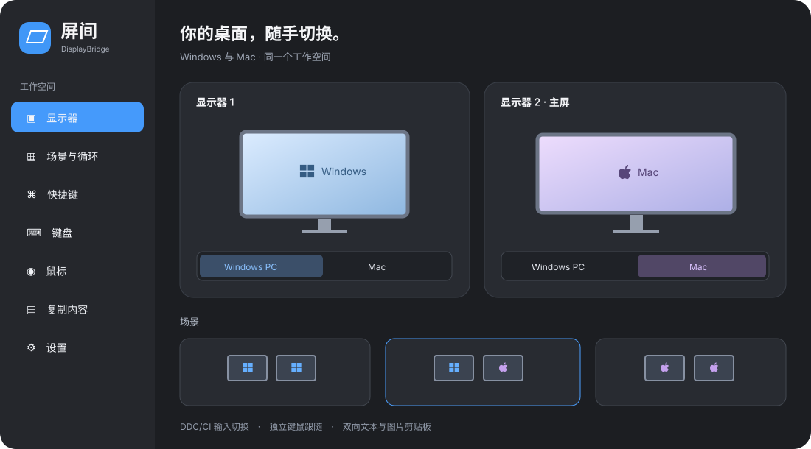

# 屏间 · DisplayBridge

**在 Windows 与 Mac 之间，切换显示器、键鼠和复制内容。**

DisplayBridge is a local-network workspace switcher for Windows and Apple Silicon Mac.

屏间是一款常驻托盘／菜单栏的桌面工具。当几台电脑各自通过 HDMI、DisplayPort 或扩展坞连接到同一组显示器时，可以用图形界面、场景和快捷键切换输入源，并按需同步键鼠连接与剪贴板。**视频仍走原有线缆，App 通过 DDC/CI 控制显示器，不传输远程桌面画面。**



*示意图使用虚构设备名称；实际可用功能取决于显示器、扩展坞和键鼠型号。*

## 下载

前往 [Releases](https://github.com/ipoolo/DisplayBridge/releases) 下载最新版：

| 附件 | 用途 |
| --- | --- |
| `DisplayBridge-0.5.0-Windows-x64.zip` | Windows x64 便携版，解压后运行 `DisplayBridge.exe`，保留整个目录 |
| `DisplayBridge-0.5.0-Mac-arm64.zip` | Apple Silicon Mac，将 `.app` 放入“应用程序”后打开 |
| `DisplayBridge-0.5.0-Source.zip` | 脱敏源码快照 |
| `*.sha256` | 对应附件的 SHA-256 校验值 |

当前为早期版本，安装包未使用商业代码签名，Mac 未公证，系统可能提示无法验证开发者。只运行从可信 Release 获取并核验的文件；也可以从源码构建。已有版本更新前先退出屏间，避免覆盖正在使用的资源包。

## 能做什么

| 功能 | 使用方式 |
| --- | --- |
| 每屏切换与状态 | 显示当前系统、输入口和已配置电脑；直接选择目标，或单屏循环 |
| 场景与循环 | 保存“全 Windows”“全 Mac”或混合布局；按自定顺序循环，跳过离线目标 |
| 图形精简模式 | 默认开启，显示器卡片与系统图标；托盘／菜单栏可直接操作场景 |
| 桌面排列 | 拖动显示器顺序，指定联动主屏；排列与名称同步到已配对电脑 |
| 自动移窗 | 当前窗口所在屏幕切离本机时，移到仍显示本机的另一屏；可关闭 |
| 快捷键 | 全局快捷键、JSON 导入导出、读取对端配置后逐项勾选合并；检查冲突 |
| 键盘跟随 | 独立“键盘”页面，MX Keys 可跟随已确认的主屏切换，默认关闭 |
| 鼠标跟随 | 独立“鼠标”页面，MX Master 3S 使用自己的开关与通道映射，默认关闭 |
| 复制内容 | 访问对端最近一条文本／图片，支持自动、切回应用时、手动收集与关闭 |
| 双向剪贴板 | 两端开启后，Windows 复制可在 Mac 直接粘贴，反向同样支持；默认关闭 |
| 登录时启动 | 可在每台电脑的设置中分别启用 |

配置快捷键、导入或合并时会暂停**屏间自身**全部快捷键，关闭编辑界面后恢复。系统和其他软件的快捷键不受影响。

## 首次使用

1. 在两台电脑安装并打开屏间，连接同一可信局域网。Windows 防火墙若询问，仅允许所需的专用网络访问。
2. 确认显示器启用了 DDC/CI；每台电脑都要有视频线连接到希望控制的显示器。扩展坞和转接器也需要支持控制通路。
3. 在“设备与连接”中生成配对码，并在另一台电脑配对。自动发现不可用时可输入局域网 IPv4 地址和页面显示的端口。
4. 先执行自动检测。应用会读取显示器输入和能力，但无法仅凭接口推断每条线属于哪台电脑；未确定时，在实际显示本机的屏幕上确认归属，或手动配置端口。
5. 按实际摆放拖动卡片顺序，选择主屏。先验证单屏切换，再配置多屏场景和快捷键。
6. 需要键鼠跟随时，在对应页面检测设备，配置每台电脑的 Easy-Switch 通道，并在两端分别打开跟随开关。只切副屏不会触发跟随。
7. 需要直接跨设备粘贴时，在两端设置中开启“双向自动剪贴板”。开启后从新复制的内容开始同步，不回填启动前或重连前的旧内容。

关闭窗口后应用继续在后台运行，完全退出请使用托盘／菜单栏的退出按钮。

## 支持范围与限制

- **系统：**提供 Windows x64、Apple Silicon Mac ARM64 构建；已在 Windows 11 与 M4 Mac / macOS 15 验证。Mac 原生组件以 macOS 13 为最低构建目标，其他版本未全面验证。暂不提供 Intel Mac 和 Linux 版本。
- **显示器：**已验证 AOC CU34G3X、ASUS ROG XG279Q。其他型号及 HDMI/DP/USB-C 扩展坞可能不支持 DDC、在非当前输入上不可读，或不接受输入切换。App 区分“指令已发出”和“回读已确认”，不把未知状态猜成成功。
- **多屏：**支持可配置的显示器分组与设备顺序；当前实机验证集中在双电脑、双显示器，更多设备尚未完整验收。
- **键鼠：**当前只控制已适配的 MX Keys / MX Master 3S，已验证蓝牙通道往返。通道号码由用户实际配对决定，没有固定的 Windows 或 Mac 通道。Mac 可能需要输入监控权限；不会记录按键或鼠标轨迹。设备休眠或刚重连时可能需要唤醒并重试，仍可使用实体 Easy-Switch 恢复。
- **剪贴板：**仅纯文本与 PNG 图片，分别最多 1 MB、8 MB，只保留最新一条。暂不支持文件、完整富文本或历史记录。双向同步会覆盖接收端剪贴板；同时复制时采用一致的更新顺序，避免循环回传。
- **离线：**循环跳过需要离线电脑的场景；直接切显示器到离线目标会先提示，确认后可能出现无信号。暂不自动唤醒电脑。
- **网络安全：**仅用于可信局域网。当前控制与配对采用 HTTP，没有 TLS；剪贴板载荷虽加密，但令牌交换不防网络监听。请阅读 [安全与隐私](SECURITY.md)。

## 从源码构建

需要 Node.js 22 或更新版本。Windows 使用系统 .NET Framework 编译器；Mac 需要原生 ARM64 Node.js 与 Xcode Command Line Tools。

```sh
npm ci
npm test
```

Windows：

```sh
npm run dist:win
```

Mac：

```sh
npm run dist:mac
```

开发启动：先运行对应的 `npm run native:win` 或 `npm run native:mac`，再运行 `npm start`。详情见 [开发指南](CONTRIBUTING.md)。

## 验证与反馈

0.5.0 已通过 Windows 63 项测试（1 项 Mac 专用测试跳过）和 Mac 64 项测试；另外验证过双屏输入切换、实际键盘／鼠标通道往返、双向文本／图片复制、快捷键合并与编辑暂停。自动测试通过不代表所有显示器和扩展坞都兼容。

反馈问题请说明应用版本、系统版本、显示器／扩展坞／键鼠型号、预期与实际表现。截图和日志请去除电脑名、IP、序列号、个人路径与剪贴板内容；不要上传配对文件。

[变更记录](CHANGELOG.md) · [安全与隐私](SECURITY.md) · [贡献指南](CONTRIBUTING.md)

## 许可证与致谢

项目采用 [MIT License](LICENSE)。Apple Silicon DDC 通路基于固定版本的 [m1ddc](https://github.com/waydabber/m1ddc)，保留原作者授权。桌面运行时为 Electron。第三方许可见 [THIRD_PARTY_NOTICES.md](THIRD_PARTY_NOTICES.md)。Windows、Apple、Logitech 等名称与商标属于各自权利人，本项目并非其官方产品。
